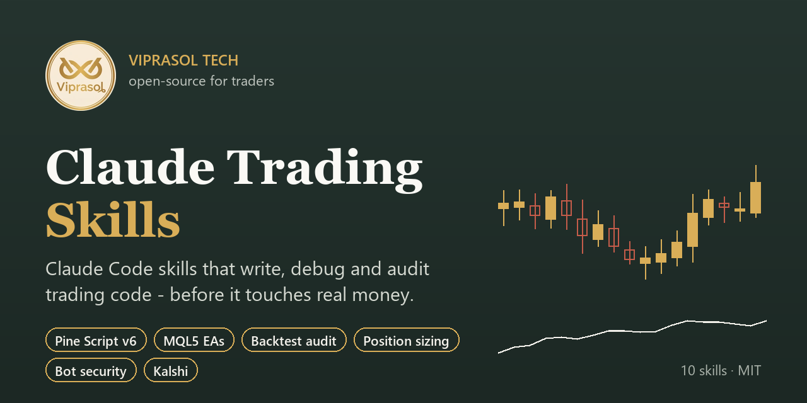

<div align="center">



### Claude Code skills for traders and trading-system developers

**Pine Script v6 · MQL5 Expert Advisors · backtest audits · position sizing · bot security**<br>
Code that compiles first time, backtests that tell the truth, and bots that do not blow up.

[](https://github.com/Viprasol-Tech/claude-trading-skills/stargazers)
[](LICENSE)
[](https://code.claude.com/docs/en/skills)
[](#-whats-inside)
[](https://github.com/Viprasol-Tech/claude-trading-skills/actions/workflows/ci.yml)

[Quick start](#-quick-start) · [What's inside](#-whats-inside) · [Examples](#-just-ask) · [Scripts](#-bundled-scripts) · [Changelog](CHANGELOG.md)

</div>

---

## 💬 Just ask

Install once, then talk to Claude Code normally. The right skill loads by itself.

```text
> Write a Pine Script v6 strategy: buy when the 20 EMA crosses above the 50 EMA,
  only above the daily 200 EMA, ATR stop, risk 1% per trade. No repainting.
> My indicator's signals disappear on the live bar. Here's the code - fix it.
> Convert this v5 script to v6 (it errors on "when" and on na bools).
> Build an MT5 EA for XAUUSD M15 from these rules, with a daily loss limit.
> Review this .mq5 before I put it on a live account.
> Here's my backtest - 312 trades, I tried about 40 parameter sets. Is it real?
> How many lots for EURUSD, $10k account, 1% risk, 25 pip stop?
> Audit my Binance bot for anything that could leak keys or double-order.
> Analyse my MT5 history export - where am I losing money?
> Build a Kalshi bot that quotes both sides of a market, demo first.
```

## 📦 What's inside

| Skill | What it does |
| --- | --- |
| 🌲 **`pine-script-writer`** | Pine Script **v6** indicators and strategies that compile clean: typed variables, v6 short-circuit rules, non-repainting `request.security()`, confirmed-bar alerts, real commission and slippage, risk-based sizing. Starts from templates checked on TradingView's compiler (0 errors, 0 warnings). |
| 🔧 **`pine-script-debugger`** | Fixes compile and runtime errors, diagnoses repainting, and migrates v4/v5 scripts to v6 with an ordered checklist of every breaking change. |
| 🤖 **`mql5-ea-builder`** | MetaTrader 5 Expert Advisors built from a production-shaped template: closed-bar signals, ATR stops, lots from `TICK_VALUE_LOSS`, `CTrade` return-code checks, hedging-safe position loops, spread and daily-loss filters, and the pre-trade checks the MQL5 Market validator runs. |
| 🔍 **`mql5-ea-reviewer`** | Ranked review of an EA: unchecked retcodes, wrong Bid/Ask side, unnormalised prices and lots, stops/freeze level, margin, magic-number collisions, per-tick noise and tester-only bugs. With a patch. |
| 📉 **`backtest-auditor`** | Finds lookahead, survivorship, overfitting and fantasy fills, then computes **PSR, Deflated Sharpe and minimum track record** to say whether the edge beats luck after all the variations you tried. |
| 📝 **`strategy-spec`** | Turns "buy when RSI is oversold" into an exact, platform-independent spec two developers would code identically. |
| ⚖️ **`position-sizing`** | Shares, futures, crypto, forex lots and binary contracts sized from the stop, always rounded down; Kelly and fractional Kelly; a risk checklist for plans and bot code. |
| 🛡️ **`trading-bot-security`** | Exchange and broker bot review: key storage and permissions, withdrawal rights, webhook auth, idempotent client order IDs, rate limits, reconciliation and kill switches. |
| 📒 **`trade-journal`** | Turns an MT5, TradingView, exchange or IBKR export into keep / stop / change: expectancy by setup, hour and side, cost drag, revenge trading, live vs. backtest. |
| 🎯 **`prediction-market-bot`** | Kalshi and Polymarket: contract maths, Kalshi's fee formula, Kelly for binary contracts, and Kalshi API v2 RSA-PSS signing that matches a working client. |

Every platform fact (Pine v6 changes and limits, MQL5 return codes and checks,
Kalshi auth) is written from the official documentation and linked inside each
skill's `reference.md`.

## ⚡ Quick start

**Option A: Claude Code plugin (recommended)**

```bash
claude plugin marketplace add Viprasol-Tech/claude-trading-skills
claude plugin install trading-studio@claude-trading-skills
```

Skills are then available as `/trading-studio:<skill>` and load automatically
when your request matches.

Want every Viprasol plugin? Add the [Viprasol marketplace](https://github.com/Viprasol-Tech/claude-plugins) once:
`claude plugin marketplace add Viprasol-Tech/claude-plugins`, then
`claude plugin install <plugin>@viprasol`.

**Option B: installer** (copies the skills to `~/.claude/skills`)

```bash
git clone https://github.com/Viprasol-Tech/claude-trading-skills
cd claude-trading-skills
bash install.sh                                        # macOS / Linux
powershell -ExecutionPolicy Bypass -File install.ps1   # Windows
```

No API keys, no accounts, no network calls. The two bundled scripts need only
Python 3.10+.

## 🧮 Bundled scripts

Both are standard-library Python with built-in self-tests, so Claude runs them
instead of doing risk maths in its head.

**`backtest_stats.py`** - returns or trade PnL in, honest verdict out:

```text
$ python backtest_stats.py returns.csv --periods-per-year 252 --n-trials 20
Observations        500 (returns)
Sharpe (per period) 0.1538   annualized 2.44
Max drawdown        10.68%   [fraction of peak equity (compounded returns)]
Win rate            57.0%   profit factor 1.47
PSR (SR > 0)        100.0%
DSR (20 trials)     93.4%
MinTRL (95%)        120 periods

POSSIBLY LUCK: significant alone, but not after correcting for the trials you ran.
```

A 2.4 annualized Sharpe looks great, until you count the 20 variations it was
picked from. That is the whole point of the Deflated Sharpe Ratio
(Bailey & López de Prado, 2014).

**`position_size.py`** - risk-based sizing that never rounds up into extra risk:

```text
$ python position_size.py risk --equity 25000 --risk-pct 1 --entry 182.50 --stop 178.00
quantity            55.0000
money_at_risk       247.5000
$ python position_size.py binary --price 0.40 --prob 0.50 --bankroll 2000
fraction            0.1667
contracts_quarter   208
```

## 🗂️ Repository layout

```text
.claude-plugin/marketplace.json          marketplace manifest
plugins/trading-studio/
  .claude-plugin/plugin.json             plugin manifest
  skills/<skill>/SKILL.md                one folder per skill
  skills/pine-script-writer/templates/   compile-checked .pine templates
  skills/mql5-ea-builder/templates/      EA_Template.mq5
  skills/*/scripts/                      backtest_stats.py, position_size.py
tests/validate_repo.py                   CI: manifests, frontmatter, links, scripts
```

## ⚠️ Disclaimer

This project is for **educational and engineering purposes only** and is **not
financial advice**. Trading stocks, futures, forex, crypto and event contracts
carries substantial risk of loss. Generated code can contain bugs: test on demo
or paper accounts first, and never trade money you cannot afford to lose. Past
performance and backtests do not predict future results. Viprasol Tech is not
affiliated with TradingView, MetaQuotes, Kalshi, Polymarket, Anthropic or any
exchange or broker mentioned here.

## 🤝 Contributing

Corrections with a link to official docs are the most valuable contribution:
platforms change. See [CONTRIBUTING.md](CONTRIBUTING.md) and run
`python tests/validate_repo.py` before opening a PR. More free Claude Code
packs from Viprasol:
[claude-ai-trading-agent-skills](https://github.com/Viprasol-Tech/claude-ai-trading-agent-skills) ·
[claude-market-data-skills](https://github.com/Viprasol-Tech/claude-market-data-skills) ·
[claude-prop-firm-skills](https://github.com/Viprasol-Tech/claude-prop-firm-skills) ·
[claude-options-trading-skills](https://github.com/Viprasol-Tech/claude-options-trading-skills) ·
[claude-tradingview-automation-skills](https://github.com/Viprasol-Tech/claude-tradingview-automation-skills) ·
[claude-crypto-bot-skills](https://github.com/Viprasol-Tech/claude-crypto-bot-skills) ·
[claude-voice-agent-skills](https://github.com/Viprasol-Tech/claude-voice-agent-skills) ·
[claude-india-stack-skills](https://github.com/Viprasol-Tech/claude-india-stack-skills) · [claude-fintech-skills](https://github.com/Viprasol-Tech/claude-fintech-skills) ·
[claude-video-editing-skills](https://github.com/Viprasol-Tech/claude-video-editing-skills).

## 📬 Contact — Viprasol Tech Private Limited

Need a custom TradingView indicator, MT5 Expert Advisor, trading bot or
fintech platform built and maintained? That is what we do.

- 🌐 Website: [viprasol.com](https://viprasol.com)
- ✉️ Email: [support@viprasol.com](mailto:support@viprasol.com)
- 💬 Telegram: [t.me/viprasol_help](https://t.me/viprasol_help) · 📱 WhatsApp: +91 96336 52112
- 🐙 GitHub: [@Viprasol-Tech](https://github.com/Viprasol-Tech) · 💼 [LinkedIn](https://www.linkedin.com/in/viprasol/) · 𝕏 [@viprasol](https://twitter.com/viprasol)
- 📈 TradingView: [@viprasol](https://www.tradingview.com/u/viprasol/) · MQL5: [viprasol](https://www.mql5.com/en/users/viprasol)

## License

[MIT](LICENSE) © 2026 Viprasol Tech Private Limited
